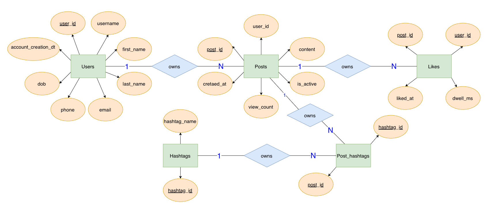

# **Course: EX603 - Data & Algorithms for Scalable Systems**
**Name: Aamnah Malik**
**Database Theme: Social Media**

## Project Title and Summary
### Social Media Engagement Database
I modelled a text-based social media platform and used SQL to explore how posts, likes, hashtags, and dwell time relate to engagement.

## Introduction
This repository will be used to store all work towards designing and building a relational database for a text-based social media platform, with an underlying structure of users, posts, likes, hashtags, post_hashtags, and a key metric of dwell_ms.

## Domain
The system I'm designing will be a text-based social media platform. Users can create as many accounts as they'd like, as long as they have unique usernames. They can create as many posts as they want to from each account, each of which will be given its own automated post_id when created. Posts can be marked as active or inactive, and their view count will be stored. Within its text content, a post can have any number of hashtags. Each post can have any number of likes, but each user can only like an individual post once. The hashtags are stored in their own table - each text string can only be created as a hashtag once, and will be assigned its own id. The associations between posts and hashtags are stored in the junction table 'post_hashtags'. 

This system is meant to be able to answer various questions about users, their performance, and their engagement. With the various metrics included across the relations, it should be able to look at how hashtags, view count, and viewing time affect the performance of a post. The system should also be able to determine which hashtags are associated with more popular posts, and which users themselves are performing at a higher rate than others. The various timestamp fields will also allow the system to look at how metrics are changing over time for different users and hashtags. All of these are valuable measures in the social media world especially for people looking to maximize their engagement.

# Entity Relationship Diagram


## Database Overview
The ERD above shows how users, posts, likes, hashtags, and post_hashtags relate to each other. The PostgreSQL DDL for creating these tables is in [schema/schema.sql](schema/schema.sql). The Unit 3 query files are in [queries/unit3/](queries/unit3/).

For the analysis, the most relevant tables are posts and likes. Posts hold the content and post-level information, while likes connect users to posts and store interaction details such as timestamps and dwell time. Hashtags and post_hashtags support analysis of which tags are associated with posts.

## Schema Definiton

users stores information about each user, including their username, name, email, phone number, date of birth, and account creation date. Each user is identified by the user_id primary key.
posts stores content created by users. Each post belongs to one user through user_id, and the table also tracks whether the post is active, its view count, and when it was created.
hashtags stores unique hashtags that can be associated with posts. Each hashtag is identified by hashtag_id, while hashtag_name must be unique.
post_hashtags is a junction table connecting posts and hashtags. This allows one post to have multiple hashtags and one hashtag to be used on multiple posts. The combination of post_id and hashtag_id forms the composite primary key, preventing the same hashtag from being associated with the same post more than once.
likes records which users have liked which posts. Its composite primary key of post_id and user_id prevents a user from liking the same post more than once. It also records when the like occurred and the user's dwell time in milliseconds

## Technical Highlights

- **Filtering and NULL handling:** Unit 3 uses `COALESCE`, `IS NULL`, and explicit filters to show how missing values affect which rows a query returns. This helped identify records omitted by a filter without producing an error.
- **Aggregations:** Unit 4 uses `COUNT`, `AVG`, conditional aggregation, and `ROLLUP` to summarize engagement by post and country. These summaries help compare activity at different levels.
- **Joins and anti-joins:** Unit 5 connects users, posts, likes, and hashtags. `LEFT JOIN`, `NOT EXISTS`, and `EXCEPT` help retain or find posts with no likes, which an inner join would hide.
- **CTEs and subqueries:** Units 3 and 4 use named intermediate results to make calculations easier to read and to compare results, such as identifying posts above an engagement threshold.
- **Window functions and query plans:** Unit 6 uses `PARTITION BY`, ranking functions, `LAG`, and running totals to compare rows while keeping their context. Unit 5 also uses PostgreSQL `EXPLAIN` to inspect the join plan.

## Findings and Recommendations

- **Check the reported failure rate before acting on it.** Unit 3 found active, flagged, and removed reaction statuses, and showed that filtering on a nullable removal reason can omit rows. I recommend correcting and validating the dashboard query before using its failure rate to make decisions about creator payouts.
- **Investigate posts with unusual like outcomes.** Unit 4 found that Post 11 had the most removed likes (5), followed by Posts 6 and 9 (4 each). Unit 5 identified Posts 14 and 15 as having no likes. These are useful places to investigate, but counts alone do not prove a cause or provide a fair failure rate; compare removed likes with total likes and check post status, visibility, and event logging.
- **Review volatile engagement and long gaps.** Unit 6 found large month-to-month changes in dwell time and long intervals without recorded likes for Posts 9 and 12. I recommend checking the event logs and post history, then monitoring the same metrics after any changes rather than assuming a gap or decline has one specific cause.

## Limitations and Future Improvements
The schema in [schema/schema.sql](schema/schema.sql) does not match all of the columns used by the Unit 3–6 analysis queries. For example, the query exercises use fields such as `post_title`, `reaction_status`, and `like_id`, while the DDL defines `content` and a composite key for likes. The repository also does not include a data-loading script for the expanded analysis dataset. I would reconcile the schema with the analysis dataset and include reproducible sample data so the reports can be run and checked end to end. More post visibility, publishing, and event-logging data would also help distinguish real inactivity from missing events.

## Video Presentation
https://www.loom.com/share/cd896b6ffa4d4dce95998f6dd6ef3904

## Query Catalogue

### Units 1–2
These units document the database model and its integrity rules; there are no standalone query files for them. 

### Unit 3

| Query | SQL file | Business question |
| --- | --- | --- |
| 3.1a–e | [q3_1.sql](queries/unit3/q3_1.sql) | Which posts and reactions match selected engagement, status, country, text, and hashtag criteria? |
| 3.2a–b | [q3_2.sql](queries/unit3/q3_2.sql) | How do NULL filters affect row counts, and how can a calculated dwell-seconds value be filtered correctly? |
| 3.3a–c | [q3_3.sql](queries/unit3/q3_3.sql) | Which posts meet the high-engagement threshold using an expression, subquery, or CTE? |

### Unit 4

| Query | SQL file | Business question |
| --- | --- | --- |
| 4.1.1 | [q4_1.sql](queries/unit4/q4_1.sql) | What are the overall dwell-time statistics, and how many distinct users have liked posts? |
| 4.1.2 | [q4_1.sql](queries/unit4/q4_1.sql) | How many likes has each post received, and what is its average dwell time? |
| 4.1.3 | [q4_1.sql](queries/unit4/q4_1.sql) | Among posts with at least 10 likes, how do like counts and average dwell times compare? |
| 4.1.4 | [q4_1.sql](queries/unit4/q4_1.sql) | How do post like counts and average dwell times vary by author country and media type? |
| 4.2.A | [q4_2.sql](queries/unit4/q4_2.sql) | How many likes has each post received, and how many of those likes were removed? |
| 4.2.B | [q4_2.sql](queries/unit4/q4_2.sql) | How many likes were received for posts by each author country, and what is the overall total? |
| 4.2.C | [q4_2.sql](queries/unit4/q4_2.sql) | Which posts have at least 75% of the dataset's maximum like count? |

### Unit 5

| Query | SQL file | Business question |
| --- | --- | --- |
| 5.1.1 | [q5_1.sql](queries/unit5/q5_1.sql) | Who liked each post, and when did they like it? |
| 5.1.2 | [q5_1.sql](queries/unit5/q5_1.sql) | Which posts are associated with the `tech` hashtag? |
| 5.1.3 | [q5_1.sql](queries/unit5/q5_1.sql) | How do posts from the same author country compare in like activity and average dwell time? |
| 5.2.A–B | [q5_2.sql](queries/unit5/q5_2.sql) | Which posts have no likes, and how do inner, left, right, and full joins treat unmatched records? |
| 5.2.C | [q5_2.sql](queries/unit5/q5_2.sql) | Which posts have never had a like, using `NOT EXISTS` and `EXCEPT`? |
| 5.3.A | [q5_3.sql](queries/unit5/q5_3.sql) | What row count results from pairing every post with every hashtag? |
| 5.3.B | [q5_3.sql](queries/unit5/q5_3.sql) | How does PostgreSQL plan the three-table activity query? |

### Unit 6

| Query | SQL file | Business question |
| --- | --- | --- |
| 6.1.1 | [q6_1.sql](queries/unit6/q6_1.sql) | How does each like's dwell time compare with the average for its post? |
| 6.1.2 | [q6_1.sql](queries/unit6/q6_1.sql) | How do `ROW_NUMBER`, `RANK`, and `DENSE_RANK` order posts by like count? |
| 6.1.3 | [q6_1.sql](queries/unit6/q6_1.sql) | Which quartile does each post fall into based on its like count? |
| 6.2.A | [q6_2.sql](queries/unit6/q6_2.sql) | How does a like's dwell time compare with the previous and next likes on the same post? |
| 6.2.B | [q6_2.sql](queries/unit6/q6_2.sql) | How do running totals, quarterly totals, and a moving average track dwell time? |
| 6.2.C | [q6_2.sql](queries/unit6/q6_2.sql) | Which posts have more than seven days between consecutive likes? |
| 6.3.A | [q6_3.sql](queries/unit6/q6_3.sql) | Which three likes have the highest dwell time for each post? |
| 6.3.B | [q6_3.sql](queries/unit6/q6_3.sql) | Is monthly dwell time increasing or decreasing compared with the previous month? |

## How to Run
These commands use `psql` and assume PostgreSQL is installed and the target database already exists. Replace `your_database` with its name.

Create the tables from the repository's DDL:

```bash
psql -d your_database -f schema/schema.sql
```

The DDL starts by dropping tables with these names, so run it only in a disposable database or after backing up any data you need. It creates the tables but does not insert sample data.

To execute a query file:

```bash
psql -d your_database -f queries/unit6/q6_1.sql
```

The Unit 3–6 query files expect the expanded exercise schema and data, which are not included here and do not exactly match `schema/schema.sql`. Load the matching schema and dataset before running those queries; otherwise they may fail because expected columns or tables are missing.
