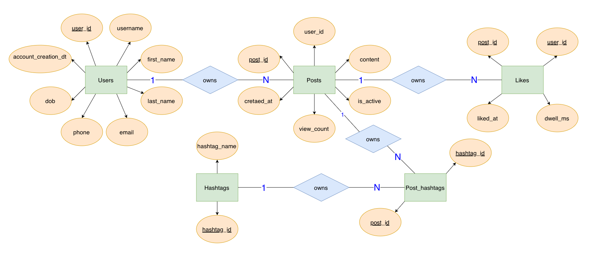

# **Course: EX603 - Data & Algorithms for Scalable Systems**
**Name: Aamnah Malik**
**Database Theme: Social Media**

## Introduction
This repository will be used to store all work towards designing and building a relational database for a text-based social media platform, with an underlying structure of users, posts, likes, hashtags, post_hashtags, and a key metric of dwell_ms.

## Domain
The system I'm designing will be a text-based social media platform. Users can create as many accounts as they'd like, as long as they have unique usernames. They can create as many posts as they want to from each account, each of which will be given its own automated post_id when created. Posts can be marked as active or inactive, and their view count will be stored. Within its text content, a post can have any number of hashtags. Each post can have any number of likes, but each user can only like an individual post once. The hashtags are stored in their own table - each text string can only be created as a hashtag once, and will be assigned its own id. The associations between posts and hashtags are stored in the junction table 'post_hashtags'. 

This system is meant to be able to answer various questions about users, their performance, and their engagement. With the various metrics included across the relations, it should be able to look at how hashtags, view count, and viewing time affect the performance of a post. The system should also be able to determine which hashtags are associated with more popular posts, and which users themselves are performing at a higher rate than others. The various timestamp fields will also allow the system to look at how metrics are changing over time for different users and hashtags. All of these are valuable measures in the social media world especially for people looking to maximize their engagement.

# Entity Relationship Diagram

## Schema Definiton

users stores information about each user, including their username, name, email, phone number, date of birth, and account creation date. Each user is identified by the user_id primary key.
posts stores content created by users. Each post belongs to one user through user_id, and the table also tracks whether the post is active, its view count, and when it was created.
hashtags stores unique hashtags that can be associated with posts. Each hashtag is identified by hashtag_id, while hashtag_name must be unique.
post_hashtags is a junction table connecting posts and hashtags. This allows one post to have multiple hashtags and one hashtag to be used on multiple posts. The combination of post_id and hashtag_id forms the composite primary key, preventing the same hashtag from being associated with the same post more than once.
likes records which users have liked which posts. Its composite primary key of post_id and user_id prevents a user from liking the same post more than once. It also records when the like occurred and the user's dwell time in milliseconds

## Query Catalogue

### Unit 4

| Query | SQL file | Business question |
| --- | --- | --- |
| 4.1.1 | [q4_1.sql](queries/unit4/q4_1.sql) | What are the overall dwell-time statistics, and how many distinct users have liked posts? |
| 4.1.2 | [q4_1.sql](queries/unit4/q4_1.sql) | How many likes has each post received, and what is its average dwell time? |
| 4.1.3 | [q4_1.sql](queries/unit4/q4_1.sql) | Among posts with at least 10 likes, how do like counts and average dwell times compare? |
| 4.1.4 | [q4_1.sql](queries/unit4/q4_1.sql) | How do post like counts and average dwell times vary by author country and media type? |
| 4.2.A | [q4_2.sql](queries/unit4/q4_2.sql) | How many likes has each post received, and how many of those likes were removed? |
| 4.2.B | [q4_2.sql](queries/unit4/q4_2.sql) | How many likes were received for posts by each author country, and what is the overall total? |
| 4.2.C | [q4_2.sql](queries/unit4/q4_2.sql) | Which posts have at least 75% of the dataset's maximum like count? |
